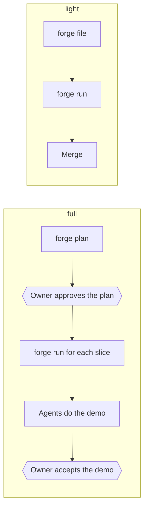

# Workflow

This file tells how work moves from an issue to a merge. An orchestrator controls the work. A subagent with a new
context does each stage. Thus each handoff goes through the issue or the pull request, not through chat history.

`<forge>` is the directory of the forge skill: the parent of the directory that contains this file. Each path that
starts with `<forge>/` is in it.

## Settings

The project settings are in `.agents/forge.md`. Words in the forge files such as "the check" and "the evidence
directory" refer to these settings. If a setting is not there, use the default.

| Setting | What it is | Default |
| --- | --- | --- |
| Process | `light` or `full`. Refer to "Process". | `light` |
| Tracker | `github` or `local`. Refer to "Tracker". | `github` |
| Repository | GitHub only: the `owner/name` that gets the issues, if it is not the repository of the checkout (for example, the parent of a fork). | The repository of the checkout |
| Check | One command that checks format, lint and tests. It is the merge gate. | None. Ask the owner. |
| Run | How to start the real program for a tester. | The steps in `README.md` |
| Evidence | The directory for screenshots and output that a tester saves. Git ignores it. | `.evidence/` |
| Roadmap | The roadmap issue. Full process only. | None |
| Backlog | The backlog issue. | None. New issues have no parent. |
| Branch | The name of a work branch. | `issue/<issue>-<short-name>` |
| Docs | The documents to keep correct, and the shape of each. | `README.md` |
| Dependencies | The rule for a new dependency. | Allowed. Give the reason in the pull request. |
| Models | The rule for model calls in tests and in live runs. | Tests make no paid model call. |
| Released | `yes` or `no`. If `no`, there is no backward compatibility to keep. | `yes` |
| Browser | The tool that a tester uses for a web interface. | `agent-browser`, or the browser tool of the agent |

The settings file also has sections for invariants, users and devices, and roster changes.

## Tracker

The "Tracker" setting selects one tracker file: `<forge>/reference/tracker-github.md` or
`<forge>/reference/tracker-local.md`. The tracker file tells how to do each tracker action: create an issue, comment,
add a label, open a pull request, merge, and the other actions. When a forge file tells you to do one of these
actions, do it as the tracker file tells.

## Process

| | `light` | `full` |
| --- | --- | --- |
| For | A small project, a tool, a library, a project with one person | A product that grows in steps, with a demo at each step |
| Tracking | Issues only. A Backlog issue is optional. | Roadmap, milestones, slices and Backlog |
| Commands | `kickoff`, `roadmap`, `file`, `run` | All commands |
| Owner decides | Stop conditions and `(owner)` checks | The milestone plan, the milestone demo, stop conditions and `(owner)` checks |
| Report | The closing comment on each issue | The report on the milestone |

Both processes use the same stages, roles, flags, stop conditions and rules. In the light process, the orchestrator
can write the spec of a small issue itself. It can merge without the owner when the review and the verification pass.



## Tracking

Full process:

```
Roadmap issue                the direction, the milestones and the open questions
├── Milestone issue          label: milestone
│   └── Slice issue          one pull request each
└── Backlog issue
    ├── Bug or later need    not part of a milestone yet
    └── Spike issue          label: spike. One question that blocks a decision.
```

A spike can also be the first slice of a milestone, when the milestone plan has an unknown.

- Only the next milestone has slices. A later milestone is a goal and a demo, nothing more.
- Only `forge kickoff` and `forge roadmap` change the Roadmap body. If the state of a milestone in it does not agree
  with the milestone issue, the milestone issue is correct.

Light process: each issue stands alone. If the project has a Backlog issue, new issues go under it. There is no
Roadmap issue. The direction is in the vision document.

Both processes:

- The label `needs-owner` marks an issue that waits for the owner. Remove the label when the owner answers.
- A "slice" is an issue that is part of a milestone. The rules for an issue apply to each slice.

## Two levels of planning (full process)

| | `forge plan` | `forge run` |
| --- | --- | --- |
| When | One time, before the milestone starts | Immediately before each slice is built |
| Spec | Goal, demo script, in scope and out of scope | Firm acceptance checks for one slice |
| Design | Only what crosses slices: module boundaries, data shapes, the API, new dependencies | The interfaces of this slice, if it has a flag |
| Depth for a slice | Title, goal, draft checks, flags, order | All of it |
| Ends with | The owner approves. The slices become issues. | A merged pull request |

The details wait until `forge run`, because each merged slice changes what the next slice needs. A detailed plan for
slice 7 that you write before slice 1 exists will be wrong when you use it.

## Stages of an issue

| # | Stage | Role | Output | Skip when |
| --- | --- | --- | --- | --- |
| 1 | Spec | Planner | The issue body: goal, acceptance checks, out of scope | Never. The orchestrator can write it for a small issue. |
| 2 | Design | Designer | One comment on the issue | The issue has no `design` flag |
| 3 | Tests first | Test author | Failing acceptance tests on the branch | The issue has no `test-first` flag |
| 4 | Build | Implementer | A pull request with code and tests | Never |
| 5 | Review | Reviewer | One review comment with a verdict | Never |
| 6 | Verify | Tester | Evidence for each acceptance check, on the pull request | The change has no behavior that a person or a caller can see |
| 7 | Merge | Orchestrator | Squash merge. A closing comment on the issue. | — |

Review and verify can send the issue back to the implementer. Do a maximum of two rounds, review and verify counted
together. A third failure is a stop condition. It usually shows that the spec or the design is wrong, not the code.

### Spikes

A spike is an issue with the label `spike`. It answers one question that blocks a decision, for example "can SQLite
sync between two devices with less than one second of delay?". Its output is an answer on the issue, not merged code.
A spike uses these stages, and skips the others:

| Stage | Role | For a spike |
| --- | --- | --- |
| Spec | Planner (role `planner`, "For a spike") or orchestrator | The question, the options, the evidence that answers it, and the time box |
| Build | Implementer in its own worktree. A researcher with no worktree if the spike needs no code. | The smallest experiment. The answer in the form of "Spike answer" in `<forge>/templates/issue.md`. No pull request. |
| Review | Reviewer (role `reviewer`, "For a spike") | Does the evidence support the answer? Is the experiment fair to each option? |
| Close | Orchestrator | Comment the answer on the issue. Delete the branch, if there is one. Close the issue. |

- Brief a researcher as a utility task (refer to "Utility tasks"), with the spike issue and the "Spike answer" form.
- If the verdict is `changes-needed`, send the findings back to the implementer or the researcher. Do a maximum of
  two rounds, as for an issue.
- If the time box ends before there is an answer, the implementer sends back what it found and what is still
  unknown. That is a result, not a failure.
- After the close, apply the answer. A spike in a milestone: `forge run-milestone` updates the later slices. Other
  spikes: tell the owner to run `forge roadmap`.

### Flags

The planner proposes the flags, each with one line of reason. In the full process, the owner sees them in the
milestone plan before the work starts. The orchestrator can add a flag. The owner can change a flag.

- `design`: the issue adds or changes an interface between modules, a stored format, a public API, or a screen.
- `test-first`: wrong behavior costs much, and you can state the behavior before the code exists. Examples: stored
  data after a crash, permissions, payments, a parser of untrusted input. A model that did not write the code
  writes the acceptance tests from the spec and the design. The implementer must make them pass. The implementer
  must not change them without a note in the pull request.
- `invariant`: the issue touches an invariant of the project. Use one more step of effort for build and review.

## Who tests what

Agents do the tests, from the smallest test to the full demo. The owner does only what an agent cannot do.

| Level | Who | How |
| --- | --- | --- |
| Tests in the code | Implementer | The check. Use fakes for the model, the network and the clock. |
| One issue, for real | Tester | Starts the real program (the "Run" setting) and does each acceptance check through the command line, the API or the user interface |
| A web interface | Tester | The browser tool (the "Browser" setting) operates a real browser. It can click, type, read the screen, and save a screenshot. |
| The milestone demo | Tester | Does the demo script from a clean start and saves the evidence |
| What an agent cannot do | Owner | A real device, a real account of the owner, or a judgment ("is this report useful?") |

A check for the owner has the mark `(owner)` and a reason in the spec. Keep these checks few. Then the owner only
reads the evidence and does the `(owner)` checks.

## Stop conditions

Stop the issue. Comment the question on the issue in the form of "Writing for a person" in `<forge>/reference/rules.md`.
Add the label `needs-owner`. Then continue with other issues that do not need the answer.

- A change that makes an invariant weaker.
- A new dependency that the "Dependencies" setting does not allow. In the full process, also a new dependency that
  the milestone plan does not name.
- The issue needs more than its spec says, or the spec is wrong.
- Two failed rounds of review and verify.
- The check can pass only if you remove a test or a check, or make it weaker.
- The work needs a paid model, real money, a real account of the owner, or real user data, and the "Models" setting
  or the milestone plan does not allow it.
- A change to the forge settings or to the forge skill. Propose it in the report (refer to "Process").
- A role has no model left in the roster.

## New issues

An agent can file an issue for what it finds during the work. File few issues. Make each issue worth the time of a
reader. Use the bug form or the change form in `<forge>/templates/issue.md`. A subagent sends the new issue back to the
orchestrator, and the orchestrator creates it.

| What you found | Where it goes |
| --- | --- |
| It breaks an acceptance check or the demo of this milestone | A new slice under this milestone. The orchestrator adds it. |
| A real defect in merged code that does not block the work | A new issue with the label `bug`, under Backlog if it exists |
| A need of a later milestone | A new issue under Backlog that names the milestone |
| A cleanup or an idea that nothing needs yet | No issue. Write it in the report (refer to "Process") if it is important. |

- Look at the open issues first. If an issue exists, comment on it.
- A bug tells what you did, what occurred, and what must occur. A reader must be able to see the bug again.

## Rules for the orchestrator

- Do not write the code and do not review it. Plan the order, brief the subagents, read the results, and keep the
  record. You can fix a small review finding (a name, a typo) yourself.
- Do not trust a report. Run the check on the branch yourself before the merge, and read the diff summary.
- Do the issues one after the other. Do two at the same time only when the plan says that they are independent and
  that they touch different modules.
- After each stage, comment on the issue: the stage, the model, the result. Keep it to a few lines.

## Checkouts

The main checkout of the repository stays on the default branch. Only the orchestrator uses it, for tracker actions
and for the merge. All other work occurs in worktrees.

| Who | Where |
| --- | --- |
| Test author, implementer | Their own worktree, on the issue branch. Before they finish, they release the branch: `git switch --detach`. Then the next stage can check it out. |
| Reviewer | No checkout. It reads the diff. |
| Tester, orchestrator before the merge | A temporary worktree with no branch, as the action "Check out a pull request" tells. Remove it after use. |

Save evidence under `<main checkout>/<evidence directory>/`, so that it stays after the worktree is removed.

## Brief for a subagent

A subagent starts with no history, and it does not load the forge skill. Give it the absolute path of each file
that it must read. Use this text:

```
You are the <role> for issue <issue> <(milestone <milestone>), if there is one>.
The main checkout of the repository is <main checkout>. <Work in your own worktree on branch <branch>.>
Read these files first, in this order:
- <forge>/reference/rules.md
- <forge>/reference/workflow.md
- <main checkout>/.agents/forge.md
- <forge>/reference/tracker-<tracker>.md
- <forge>/roles/<role>.md
The issue: <for the local tracker, the absolute path of the issue file>.
<The pull request, if there is one.>
<What is special about this task, in one or two lines: the flag, the finding to fix.>
Send back what the role file asks for under "Send back".
```

Replace `<forge>` and `<main checkout>` with absolute paths. If the project has its own `AGENTS.md`, add it to the
list after `forge.md`.

A role file tells the subagent to comment or to write to the tracker. If the tracker is `local`, or if the subagent
cannot write to the tracker, it sends the text back. Then the orchestrator writes it.

## Delegation

Use the first method that your tool has.

1. **T3 Code (`delegate_task`).** Use `<forge>/reference/roster.md` to select the provider, the model and the effort.
2. **The subagent tool of your agent.** Use the roster model if your agent has it. If not, use a model that your
   agent has, and write the model on the issue. The reviewer and the tester must use a different model from the
   implementer, if your agent has two models. If it has only one model, write on the issue that the review was not
   independent. In the full process, ask the owner before the first build.
3. **No subagents.** Do each stage yourself, in order. Before each stage, read only what the role file tells you to
   read. Write on the issue that the review was not independent. In the full process, ask the owner before the first
   build.

## Documents that the owner approved

`forge kickoff` and `forge roadmap` change documents that no issue owns, for example `docs/vision.md`. The owner
approves the text first. Then:

1. Write the files in the main checkout, on the default branch.
2. Commit only these files, and the issue files that the command changed (local tracker). Use `git commit -s`. Name
   the command in the message.
3. If there is a remote, push. If the remote refuses the push, push a branch and open a pull request with no
   "Closes" line. Tell the owner.

## Utility tasks

Each role can ask the orchestrator for one. They use the last row of the roster.

- **Explorer:** a question about this repository. Read only. The answer refers to `path:line`.
- **Researcher:** a fact from outside, for example a library or an API. The answer gives links. It tells what was
  read: the source, the documents, or only a README.
