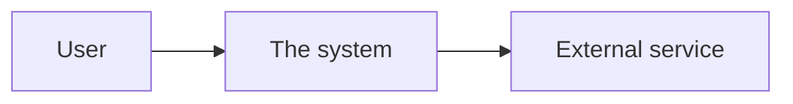

# Architecture

<One paragraph: the shape of the system and the main reason for it.>

## Context

A small Mermaid diagram showing the system, its users, and external systems.

## Parts

| Part | What it does | Technology | Status |
| --- | --- | --- | --- |
| <part> | <one line> | <language, framework, library> | planned |

## Data

What the system stores, where, in what format, and what flows between parts.

## Choices

Decisions that are hard to reverse, with rationale and the best rejected alternative.

- **<Choice>.** <Reason.> We did not use <option>, because <reason>.

## Unknowns

Open technical questions live in "Open questions" in `docs/vision.md`, each linked to its spike.
