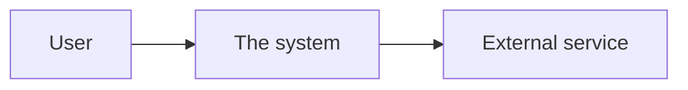

# Architecture

<One paragraph: the shape of the system, and the main reason for that shape.>

## Context

A small Mermaid diagram: the system, its users, and the external systems that it uses.

## Parts

| Part | What it does | Technology | Status |
| --- | --- | --- | --- |
| <part> | <one line> | <language, framework, library> | planned |

## Data

What the system stores, where, and in which format. What data goes between the parts.

## Choices

Each choice that is difficult to change later, with the reason and the best option that we did not use.

- **<Choice>.** <The reason.> We did not use <option>, because <reason>.

## Unknowns

The technical questions that are open are in "Open questions" in `docs/vision.md`, each with its spike.
